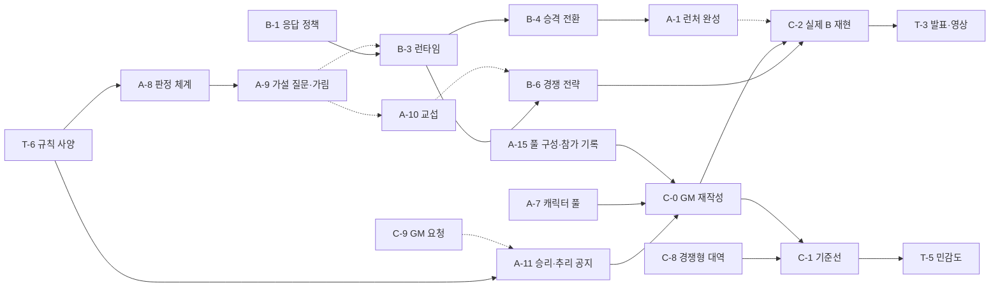

# 게임 완성까지 남은 기능·코드 목록

2026-10-19 기준. A `b477cb0`, B `f916097`, C `gm-engine-v1` 브랜치.
**개정:** 같은 날 경쟁 게임 결정, 기획서 v1.1(Role·고정 MBTI·GM 유임·서브 미션·간접 단서), v1.2(GM 담당 결정)를 반영했다. 확정 규칙은 [기획서 v1.2](GAME_SPEC_v1.2.md)가 기준이다(결정 경위는 [기획 수정안](PLAN_REVISION_20261019.md), [SOURCE_RULES.md](SOURCE_RULES.md)). GM이 엔진에 요청한 변경은 [GM 인터페이스 요청](GM_ENGINE_REQUEST_20261019.md)에 있다.

"완성"의 기준: 영속 풀의 같은 에이전트들이 실제 LLM으로 GM 1명 + 플레이어 n명을 맡아 A 엔진 위에서 **먼저 정답을 맞히는 경쟁**을 끝까지 진행한다. 숨김·교섭·NPC 판정·장애·인간 개입·게임 간 학습이 기록으로 남고, 발표용 평가 수치와 2~3분 시연 영상을 만들 수 있어야 한다.

상태 표기: ✅ 완료 · 🟡 일부 · ⛔ 없음/차단 · ✖ 폐기. 우선순위: P0(시연 성립) > P1(설득력) > P2(확장).

## 0. 경쟁 게임 결정으로 바뀐 것

| 변경 | 내용 |
|---|---|
| 게임 성격 | 협력 팀 + 선택적 공유 → **먼저 정답을 맞히는 경쟁.** 거짓말 불가, 숨기기 가능 |
| GM | 팀 작업 배정자 → **게임 마스터 (역할 배정·진행·공지·심판).** 성과는 진행 완결·배정 균형·탐색·기록으로 평가 |
| 용어 | task는 기획 용어에서 뺐다(v1.1). 기획 단위는 **Role**(캐릭터 시트 + MBTI, 플레이어는 goal 추가)이고 GM이 Role을 배정한다. 엔진 v1의 행동 단위 작업(`tasks`)은 경쟁 모드에서 쓰지 않음 |
| 질문 | 자유 주제 질문, 질문자 주사위만 판정 → **가설 질문 + 접근 4종 + 주사위 대결.** 대성공 시 플레이어에게서도 1개 강제 |
| NPC | 장애 플레이어만 NPC, 주사위 성공 시 무조건 제공 → **goal이 없는 캐릭터.** 역할·능력치·성향은 플레이어와 같은 스키마, 능동 행동 없음, 같은 판정 규칙으로 반응 |
| 공개 범위 | 결과 유형이 질문자에게 드러남 → **거절과 미보유를 구분 불가.** 제3자는 질문 쌍만 봄 |
| 공유 | 자발적 공유 → **비구속 교섭**과 보유 공개(구 부분 공개) |
| 폐기 | A-3 task 질문 대상, 기존 C-4 협력형 충돌 중재, 기존 B-6 자발적 공유 |
| 기존 결정 재확인 | 오답 사망 → 시체(단서 휘발), 자신도 모르는 범인 플레이어 가능, 플레이어 초기 단서 0개, 마감 120사이클 |
| 캐릭터 체계 | 캐릭터 시트(스테이터스·직업 스킬), MBTI는 플레이어 에이전트에 고정되고 NPC는 남은 MBTI 중 무작위(한 게임 안에서 중복 없음), 캐릭터 간 관계성 0~100(시작 50) |
| 질문 결과 | 양은 주사위가 강제, 형태는 응답자: 1성공 모호 1, 2성공 확실 1 또는 모호 2 선택, 3성공 확실 1 + 모호 2 |
| 에이전트 구성 (v1.1·v1.2) | GM 담당 1(풀 생성 시 고정 지정, 유임) + 플레이어 16(MBTI 16종 고정). 한 게임 플레이어 3~12명, 커버리지 전에는 12명. 중간 참가 없음: 에이전트 → NPC만 있고 NPC → 에이전트는 없음 |
| 서브 미션 (v1.1) | 개인 목표를 대체. 인당 상·중·하 3개. 엔진이 후보를 뽑고 판정하며, GM이 고르고 지정 대상을 정함 |
| 간접 단서 (v1.1·v1.2) | 자정 위치·동행 진술, 엔진의 사건 타임라인에서 생성. 서술은 에이전트끼리, 모순 검사는 엔진. GM은 관여하지 않음 |
| Role 배정 (v1.2) | 첫 게임 무작위, 커버리지 전 탐색, GM이 참가 기록으로 직업 역량을 가중 평균(w = (n/(n+5))²)으로 자체 산정 |
| LLM (v1.2) | 모든 에이전트가 데모 API 게이트웨이를 사용. 테스트·대역 실행에서는 호출 금지 |

## 1. 현재 동작하는 것

| 구성 | 상태 | 근거 |
|---|---|---|
| A 외부 연결 API v1 (풀·GM 선발/승계·단계·운영자 명령·피드백) | ✅ | `Game-engine/INTEGRATION_CONTRACT.md` |
| A의 질문·NPC·공유 규칙 | 🟡 | 협력형 전제로 구현되어 경쟁 규칙으로 교체가 필요 (A-7~A-10) |
| C GM v1 기반 (클라이언트·승계·원장·단계 진행·초기 활성화) | ✅ | `engine_v1.py`, `test_engine_v1.py` |
| C GM의 역할 배정 (활성화·직업·성향·goal·결원 보충) | 🟡 | 구 형식(직업·성향 4종·개인 목표 3종). v1.2의 Role 배정·서브 미션으로 교체하고 결원 보충은 제거 (C-0) |
| C GM의 행동 작업 배정 planner | 🟡 | 협력형. 제거 (C-0) |
| 실제 B LLM 플레이어의 v1 연결 | ⛔ | B-1~B-3 |

## 2. B 플레이어 (Agent_Reasoning)

| # | 우선 | 항목 | 현재 상태 | 완료 조건 |
|---|---|---|---|---|
| B-1 | P0 | 응답 정책 | ⛔ `respond_to_question()`이 `return True, ""`로 끝남 | 가설 질문을 받으면 내줌·최소 응답·거절을 결정한다. 소유 ID만 반환하고 판단 이유를 로그로 남긴다 |
| B-2 | P0 | `adapter.py` 실행 가능화 | ⛔ `ActionRequest` NameError | 독립 dict 요청을 쓰거나 B-3로 대체 |
| B-3 | P0 | v1 플레이어 런타임 루프 | ⛔ | session → observe → 수신함·교섭함 처리 → 판단 → 행동 → 결과 반영. 독립 heartbeat |
| B-4 | P0 | GM 승격 시 역할 전환 | ⛔ | role이 `gm`이 되면 플레이어 맥락을 버리고 C `GMWorker`에 자격을 넘긴다 |
| B-5 | P0 | 사건 자료 검색 사용 | ⛔ | `documents/search` 호출과 근거 인용 로그 |
| B-6 | P0 | **경쟁 전략: 질문·숨김·교섭** | ⛔ | 클루식 가설 구성(아는 후보로 채우고 미지 하나), 접근 방식 선택, 보유 모호화, 교섭 제안·이행·파기 판단, 추리 단계의 추론과 도전/유보 판단(확신도·추론 토큰 수 기록) |
| B-7 | P1 | 보유 공개 → 내용 공개 반영 | 🟡 | 같은 ID가 보유 공개 뒤 내용 공개로 오면 신념에 반영 |
| B-8 | P1 | 게임 간 학습 | ⛔ | 공식 피드백·평판 기록으로 전략 갱신, 다음 게임 판단 변화 기록 |
| B-9 | P1 | 테스트·문서 복구 | ⛔ | 단위 테스트, 실제 파일 구성에 맞는 README |
| B-10 | P1 | 상대 모델 | ⛔ | 공개된 질문 쌍과 교섭 이력으로 상대의 진척·관심·신뢰도를 추정 |

## 3. A 엔진 (Game-engine)

| # | 우선 | 항목 | 현재 상태 | 완료 조건 |
|---|---|---|---|---|
| A-1 | P0 | 공통 런타임 실행기 (런처) | ⛔ | 엔진 + 풀 등록 + B 플레이어·C GM 프로세스를 한 명령으로 실행·종료 |
| A-2 | P1 | 관전·운영 화면 | 🟡 CLI만 | v1 게임의 질문 쌍·판정·교섭·GM 결정·장애·운영자 개입 표시. 시연 녹화용 |
| A-3 | — | task 질문 대상 필드 | ✖ | GM이 플레이어 task를 배정하지 않으므로 폐기 |
| A-4 | — | 자원 배정 창 | ✖ | 경합 자원을 두지 않기로 해 폐기 (시체 외 단서는 휘발되지 않고 각자 획득 가능) |
| A-5 | P1 | 실험 지원 | ⛔ | 판정 수치 프리셋, seed 일괄 실행, 결과 내보내기 |
| A-6 | P1 | 오답 사망·시체 | 🟡 C 모의 엔진에만 있음 | 오답 고발 시 즉시 사망 → 시체, 사이클마다 단서 휘발, 시체 주사위 조사 (기존 사용자 결정) |
| A-7 | P0 | **캐릭터 시트 이식** | ⛔ v1에 없음 (1인용 엔진에만 12명) | [캐릭터 시트](CHARACTER_SHEETS_20261019.md)의 12명을 플레이어·NPC 공통 스키마로 이식(스테이터스·스킬·출발 칸). 플레이어는 에이전트 고정 MBTI, NPC는 남은 MBTI 중 무작위, 범인은 12명 전체에서. 플레이어 초기 단서 0개. 배정 안 된 캐릭터는 goal 없는 NPC, 무작위 이동 |
| A-8 | P0 | **판정 체계** | 🟡 단일 능력치·1d6 | 주사위 2개 + 준비 1, 관찰·화술·위압 기준선(8 − 스탯), 스킬·관계성 조정, 접근 4종, 성공 수별 공개량 강제와 응답자 형태 선택(2성공 확실 1 또는 모호 2), NPC의 MBTI·관계성 확률, 판단 기록 |
| A-9 | P0 | **가설 질문·결과 가림·공개 범위** | ⛔ | 가설 payload, 가설과 맞는 단서 최대 1개, 질문자에게 거절·미보유 구분 불가, 제3자에게 질문 쌍만 공개 |
| A-10 | P1 | **비구속 교섭 프로토콜** | ⛔ | 제안·수락·거절·역제안, 각자 1:1 비공개 이전, 이행·불이행 기록과 평판 피드백 |
| A-11 | P0 | **승리·추리 공지·GM 성과 기록** | 🟡 첫 정답 시 해결 기록만 있음 | 추리 결과(도전자, 성공/사망) 전체 공지·내용은 성공 시만, 추리 단계 일괄 판정(도전/유보, 정답자 공동 승리, 추론 토큰 수 순 순위·차등 점수), 마감 120사이클, 승자·생존·순위 피드백, GM 성과를 진행·균형·탐색·기록 점수로 기록. 종료 사유 확장(승자·전원 사망·마감·플레이어 0명), 공지 명령. 역할 배정(`activate`)이 캐릭터·서브 미션을 지정하도록 확장, 경쟁 모드에서 행동 작업(`tasks`) 비활성 ([요청](GM_ENGINE_REQUEST_20261019.md) R3·R4·R7~R9) |
| A-12 | P0 | **관계성** | ⛔ | 캐릭터 쌍별 0~100(시작 50), 질문·심문·협박·교섭 결과에 따른 변동, 판정 기준선 반영, 관찰 범위(수정안 Q8) |
| A-13 | P0 | **서브 미션** | ⛔ | 58종 catalog, 플레이어별 난이도별 후보 3개 추출(직전 게임 제외), 엔진 판정·달성 알림, 점수 반영, 종료 후 전원 공개 (요청 R2·R5) |
| A-14 | P1 | **간접 단서·사건 타임라인** | ⛔ | 자정 위치·동행 생성, 풀 수 있는 사건인지 검증, 넘어갈 때 연결 여부 기록, 서술 모순 검사(주체 엔진으로 확정, v1.2) |
| A-15 | P0 | **풀 고정 구성·참가 기록** | ⛔ 게임마다 GM 재선발 | 풀 생성 시 GM 1 고정 + 플레이어 16 MBTI 고정, GM 유임, 승계 `active_then_pool`, 에이전트별 참가 기록(캐릭터·직업·점수·참가 순번) (요청 R1·R6·R10) |

## 4. C GM (gm_coordinator)

| # | 우선 | 항목 | 현재 상태 | 완료 조건 |
|---|---|---|---|---|
| C-0 | P0 | **게임 마스터 정책으로 재작성** | 🟡 배정·지표 순수 함수 완료(`role_policy`·`mission_policy`·`gm_metrics`), 엔진 연결 대기 | v1.2 C1 Role 배정(첫 게임 무작위, 커버리지 전 탐색, 직업 역량 가중 평균, 대안 2개 이상과 이유 기록), 서브 미션 선택·지정 대상, 진행·추리 공지·마감 경고, 확장된 종료 조건, 공정성 감시, 성과 지표(C4) 산출. 행동 작업 배정과 결원 보충(`replace_fault` 활성화) 제거 |
| C-1 | P0 | 기준선·다중 seed | ⛔ | 조건 예시: GM 역할 배정(균형·탐색) vs 무작위 배정, 경쟁 전략 vs 무작위 플레이어, **응답 형태 직접 선택 vs 성향 확률**. seed별 분포와 캐릭터·MBTI별 승률 편중 보고 |
| C-2 | P0 | 실제 B 재현 | ⛔ | 경쟁형 시나리오(정상·플레이어 장애·GM 장애·인간 개입)를 실제 B로 실행 |
| C-3 | P1 | GM 게임 간 학습 | ⛔ | 직업 역량 산정은 C-0에 포함(v1.2). 남은 것: 커버리지 후 균형·탐색 대안의 비중을 진행·공정성 지표로 조정 |
| C-4 | — | 협력형 충돌 중재 | ✖ | 경쟁 게임에서 GM이 중재하지 않으므로 폐기 |
| C-5 | P2 | GM의 LLM 판단 여부 | 🟡 규칙 기반 | 호출 경로는 데모 게이트웨이로 확정(v1.2 0.5). 비용 때문에 규칙 기반을 유지하고 필요할 때만 도입 |
| C-6 | P1 | 추적표·평가 지표 | ⛔ | 성향별 승률, 숨김·공개율, 교섭 이행률, 강제 공개 빈도, 질문 쌍에서 새어 나간 정보 |
| C-7 | P2 | 독립 heartbeat 스레드 | 🟡 | LLM GM일 때만 |
| C-8 | P0 | **경쟁형 플레이어 대역** | 🟡 판단 로직 완료(`competitive_player`), 엔진 형식 연결·교섭 대기 | 숨김·클루식 가설·응답 형태 선택·간접 단서 응답·교섭 파기·서브 미션 추구를 하는 스크립트 플레이어와 무작위 플레이어. B 없이 엔진·GM 검증용, LLM 호출 없음 |
| C-9 | P0 | **GM 인터페이스 요청** | ✅ 10-19 작성 | [요청서](GM_ENGINE_REQUEST_20261019.md) R1~R10. 엔진 반영 후 C-0 연결 |

## 5. 공동

| # | 우선 | 항목 | 완료 조건 |
|---|---|---|---|
| T-1 | P0 🟡 | v1 기본값 합의 | 인원(3~12)·중간 참가 없음·Role 배정·간접 단서 검사 주체는 v1.2에서 확정. lease·승계 후보 기준 등이 남음 |
| T-2 | P0 🟡 | LLM 설정 | 호출 경로(데모 게이트웨이)·모델 기본값·테스트 호출 금지는 v1.2에서 확정. 호출 예산이 남음 |
| T-3 | P0 | 발표 자료·시연 영상 | 문제 정의, 역할 표, 상호작용도, 결과 수치, 녹화용 seed·로그 |
| T-4 | P1 | 게임 간 학습 실험 | 같은 풀 반복 실행, 평판·전략 변화 사례 |
| T-5 | P1 | 민감도 분석 | 판정 수치, 강제 공개 경계, 공개 범위에 따른 결과 변화 |
| T-6 | ✅ | **경쟁 규칙 사양 확정** | 10-19 완료. 규칙 항목 Q1~Q13·Q15~Q17·Q21~Q22 확정 ([기획 수정안](PLAN_REVISION_20261019.md) 8.1절) |

## 6. 의존성 분석

- **강한 의존:** 선행 항목이 없으면 구현할 수 없다.
- **약한 의존:** 먼저 만들 수 있지만 실제 검증이 뒤로 밀린다.
- **사양 의존:** 상대 구현이 아니라 합의된 메시지 형식만 있으면 시작할 수 있다.
- **결정 의존:** 팀 합의가 선행 조건이다.

| 항목 | 강한 의존 | 약한/사양 의존 | 결정 의존 | 근거 |
|---|---|---|---|---|
| T-6 규칙 사양 | 없음 | — | — | 설계안을 회의에서 확정 |
| A-7 캐릭터 풀 | 없음 | A-8 (반응 동작) | — | 캐릭터 데이터·배치는 1인용 엔진에서 바로 옮김 |
| A-8 판정 체계 | — | A-12 (관계성 보정) | T-6 | 스테이터스·스킬·주사위 수(Q1·Q2) 확정 필요 |
| A-9 가설 질문·가림 | A-8 | — | T-6 | 같은 질문 처리 경로 |
| A-10 교섭 | — | A-9 | T-6 | 별도 경로지만 보유 공개를 공유 |
| A-11 승리·추리 공지 | — | — | — | 규칙 확정됨(Q22) |
| A-1 런처 | — | B-3, B-4 | — | 골격은 지금 가능 |
| A-2 관전 화면 | — | A-9, A-10 | — | 기존 데이터로 시작, 새 이벤트는 나중에 추가 |
| A-5 실험 지원 | 없음 | A-8 | — | 수치 프리셋은 판정 체계 뒤 |
| B-1 응답 정책 | — | A-9 사양 | — | 가설 형식만 합의되면 고정 입력으로 개발 |
| B-3 런타임 | B-1 | A-9, A-10 사양 | — | 응답 단계가 B-1 반환 형식 사용 |
| B-4 승격 전환 | B-3 | — | — | 세션 폴링이 B-3 안에 있음 |
| B-5 자료 검색 | B-3 | — | — | 플레이어 자격 필요 |
| B-6 경쟁 전략 | B-3 | A-8~A-10 사양 | — | 실제 판정·교섭이 있어야 검증 |
| B-7 내용 공개 반영 | 없음 | A-10 | — | 신념 로직은 지금 수정 가능 |
| B-8 게임 간 학습 | B-3 | A-10 (평판) | — | 반복 실행 필요 |
| B-10 상대 모델 | B-3 | A-9 (질문 쌍 공개) | — | 공개 정보가 입력 |
| A-12 관계성 | — | A-7 | T-6 | 판정(A-8)과 같은 경로에서 변동·반영. 수치는 Q8 |
| C-0 GM 재작성 | A-7, A-11, A-15 | A-13 | C-9 | 캐릭터 풀, Role 배정 형식, 종료·공지·성과 API, 참가 기록이 있어야 함 |
| C-8 경쟁형 대역 | — | A-8~A-10 사양 | — | 사양대로 먼저 작성, 엔진 구현 후 실행 |
| C-1 기준선 | C-8, C-0 | A-5 | — | 경쟁형 대역과 GM 정책이 비교 대상 |
| C-2 실제 B 재현 | B-1, B-3, B-4, B-6, C-0 | A-1 | — | 경쟁 시나리오 전체 |
| C-6 지표 | — | A-9, A-10, B-3 | — | 이벤트·로그 필요 |
| T-3 발표·영상 | C-2 | A-2, C-1 | — | 실제 공동 실행 장면과 수치 |
| T-4 학습 실험 | B-8, C-3 | A-1, A-5 | — | 같은 풀 반복 |
| T-5 민감도 | C-1 | A-5 | — | 판정 수치 변화 |

## 7. 독립적으로 바로 시작할 수 있는 기능

| 담당 | 항목 | 비고 |
|---|---|---|
| 공동 | **T-6** 규칙 사양 확정, T-1, T-2 | 임계 경로의 출발점. 회의 1회 |
| A | **A-7** 공통 캐릭터 풀 이식, A-1 런처 골격, A-2 화면 골격 | A-7은 규칙과 무관한 데이터 작업. C-0 역할 배정의 입력 |
| B | **B-1** 응답 정책 (가설 형식 가정), B-2, B-7, B-9 테스트 | 가설 질문 형식은 설계안 3.1을 가정 |
| C | **C-9** 인터페이스 요청(완료), **C-8** 경쟁형 대역, C-0 중 Role·서브 미션 배정과 성과 지표 계산을 순수 함수로 작성 | 엔진 구현 전에는 단위 테스트로만 검증. LLM 호출 없음 |

## 8. 순차적으로 해결해야 하는 흐름

실선은 강한 의존, 점선은 약한·사양 의존이다.

**① 임계 경로: 규칙 → 엔진 → 플레이어 → 공동 실행**
`T-6 → A-8 → A-9 → (B-3 검증) → B-6 → C-2 → T-3`
경쟁 결정 이후 임계 경로의 출발점이 **규칙 합의와 A 엔진**으로 옮겨졌다. B의 B-1·B-3은 사양만 있으면 병렬로 시작할 수 있지만, 경쟁 전략(B-6)의 실제 검증은 A-8·A-9가 끝나야 가능하다.

**② GM 재작성**
`T-6 → A-11 → C-0 → C-2`
C의 GM 정책 재작성은 캐릭터 풀(A-7)과 승리·공지·성과 기록 API(A-11)가 나와야 끝난다. 그 전에는 대안 설계와 대역(C-8) 작성으로 준비한다.

**③ 플레이어 기본 루프**
`B-1 → B-3 → B-4 → A-1`
기존과 같다. 승격 전환과 런처는 규칙 변경의 영향을 거의 받지 않는다.

**④ 평가**
`C-8 + C-0 → C-1 → T-5`, 이어서 C-2 이후 실제 B로 재실행해 T-3 수치를 낸다.

**⑤ 교섭과 평판**
`A-9 → A-10 → B-6·B-8`
교섭은 시연에 필수는 아니다(P1). 다만 평판 기반 학습(B-8)의 입력이 된다.

## 9. 권장 진행 순서

| 단계 | 병렬 진행 | 끝나는 조건 |
|---|---|---|
| 1 | 공동: T-6·T-1·T-2 · A: A-7 · B: B-1, B-7 · C: C-9 요청, C-8 작성 | 규칙 사양 확정, NPC 데이터 이식 |
| 2 | A: A-8, A-11, A-15 · B: B-3 · C: C-0 배정·지표 순수 함수 | 판정 체계와 추리 공지·성과 기록 API 동작 |
| 3 | A: A-9, A-1 골격 · B: B-4, B-5 · C: C-0 완성, C-8 실행 | 경쟁형 대역으로 엔진 + GM 시나리오 통과 |
| 4 | A: A-10, A-1 완성 · B: B-6 · C: C-1 | 런처로 GM 1 + 실제 B 플레이어 2 실행, 기준선 1차 |
| 5 | C: C-2 · B: B-8, B-10 · 공동: 실제 LLM 실행 | **경쟁 시나리오 실제 B 재현 = 공동 실행 1차 완료** |
| 6 | 공동: T-3, T-4, T-5 · A: A-2 | 발표 자료·시연 영상·평가 수치 |
